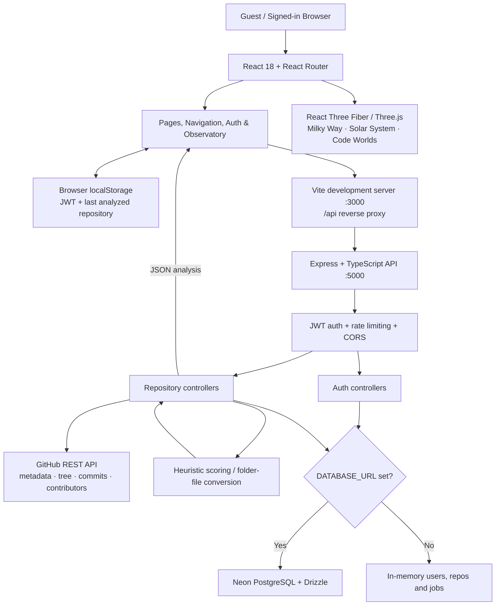
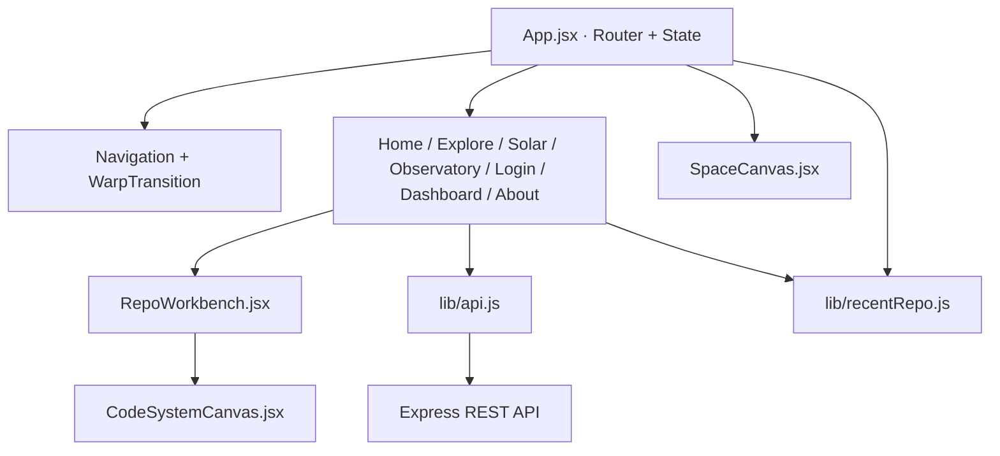
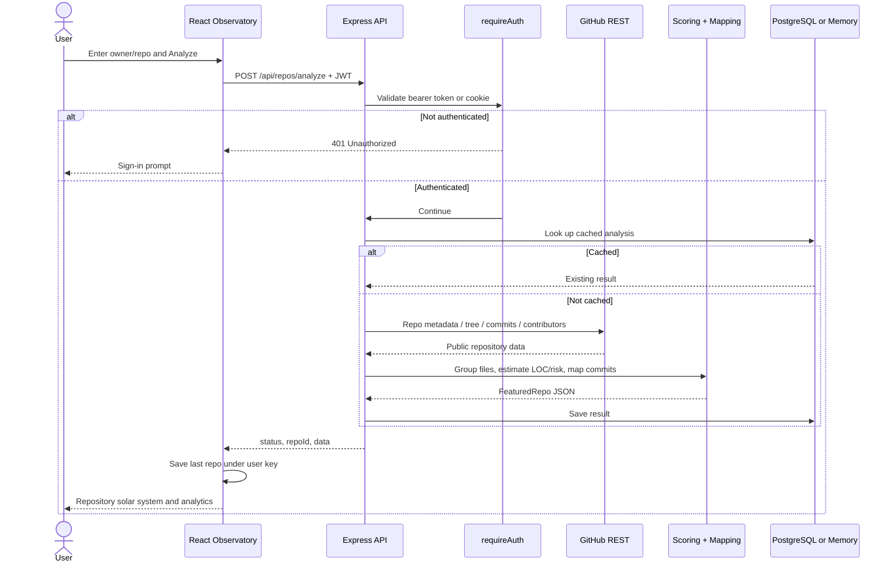
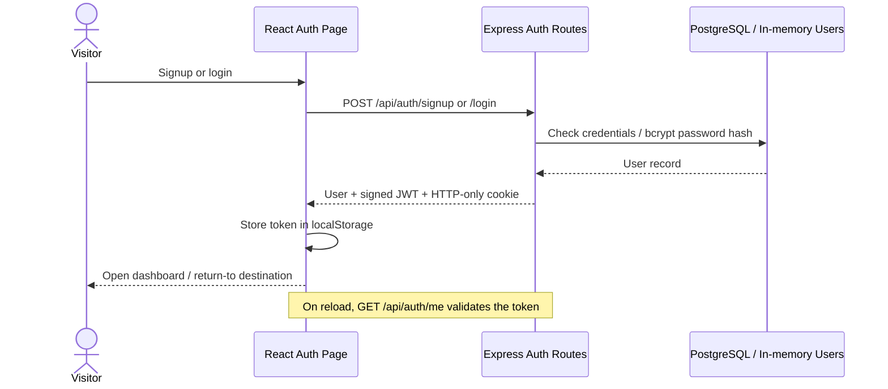
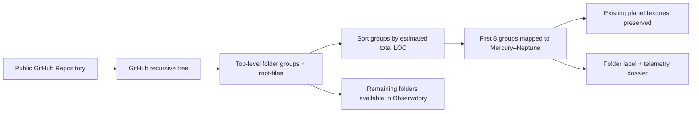
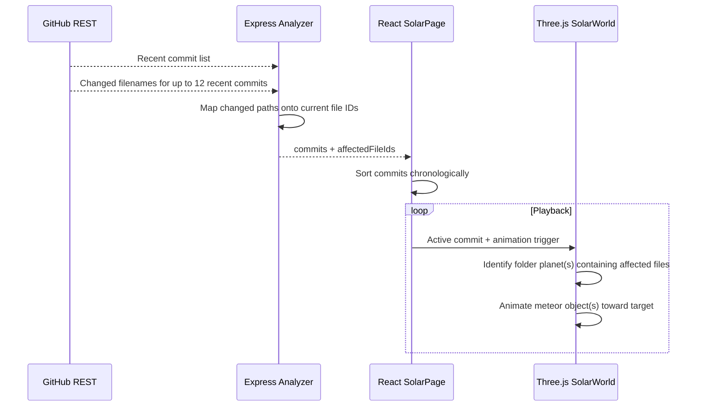

# 🌌 CodeGalaxy NOVA
### Immersive 3D Milky Way · Solar System · GitHub Repository Observatory

[](https://github.com/Vraj-Ramavat/WAD_Codex/actions/workflows/verify-nova.yml)


> **A galaxy you can explore. A solar system that becomes your codebase. A timeline in which GitHub commits become incoming meteors.**
>
> CodeGalaxy NOVA is an original React/Three.js interface developed from the ideas behind [WAD_review](https://github.com/Vraj-Ramavat/WAD_review). It connects a cinematic astronomy experience to an authenticated GitHub repository-analysis API. Guests can explore space; signed-in visitors can analyze public repositories, inspect a 3D architecture, and return to their most recently analyzed repository.
>
> **Documentation scope:** This README describes the implementation on the `main` branch as of **29 October 2026**. It distinguishes implemented behavior from visual metaphors, estimates, and future work.

**Repository:** https://github.com/Vraj-Ramavat/WAD_Codex  
**Original project/reference:** https://github.com/Vraj-Ramavat/WAD_review  
**App directory:** [`CodeGalaxy-NOVA/`](CodeGalaxy-NOVA/)  
**Local frontend:** http://localhost:3000  
**Local API:** http://localhost:5000  
**API health:** http://localhost:5000/api/health

---

## Contents

1. [Project overview](#1-project-overview)
2. [What users can do](#2-what-users-can-do)
3. [System architecture](#3-system-architecture)
4. [Technologies and dependencies](#4-technologies-and-dependencies)
5. [Repository structure](#5-repository-structure)
6. [Frontend: routes and screens](#6-frontend-routes-and-screens)
7. [3D rendering and visual design](#7-3d-rendering-and-visual-design)
8. [From repository to planets](#8-from-repository-to-planets)
9. [Commit timeline and meteor animation](#9-commit-timeline-and-meteor-animation)
10. [Authentication, authorization, and user journeys](#10-authentication-authorization-and-user-journeys)
11. [Backend services and analysis pipeline](#11-backend-services-and-analysis-pipeline)
12. [API reference](#12-api-reference)
13. [Data formats and persistence](#13-data-formats-and-persistence)
14. [Installation and running locally](#14-installation-and-running-locally)
15. [Configuration and security](#15-configuration-and-security)
16. [Build verification and testing](#16-build-verification-and-testing)
17. [Production deployment considerations](#17-production-deployment-considerations)
18. [Troubleshooting](#18-troubleshooting)
19. [Technical limitations and roadmap](#19-technical-limitations-and-roadmap)
20. [Development guide](#20-development-guide)
21. [Credits and asset attribution](#21-credits-and-asset-attribution)

---

## 1. Project overview

### 1.1 The problem

A GitHub repository is usually examined through files, directories, commit lists, and analytics tables. Architectural structure, ownership, complexity, and changes can be hard to understand at a glance. Traditional 2D dashboards communicate metrics but rarely provide an intuitive spatial metaphor for the relationships between modules.

CodeGalaxy NOVA explores a different interaction model:

- A **repository becomes a star system**.
- Its **folders become orbiting planets**.
- Its **files become moons** in the full Code Observatory view.
- Its **commits become events on a timeline**.
- Known changed files can produce **meteor animations aimed at the planets representing their folders**.
- The **Milky Way is an exploration hub** containing selectable markers for featured repositories.

The astronomy interface is also a standalone experience: guests can navigate the galaxy and the ordinary eight-planet Solar System without signing in.

### 1.2 Design principles

| Principle | Implementation |
| --- | --- |
| Immersion first | A full-screen WebGL scene, orbit controls, procedural stars, textured planets, halo effects and page transitions |
| Preserve original purpose | GitHub repository analysis, metrics, contributors and structure are integrated into the new frontend |
| Understandable mapping | Repository → star; folder → planet; file → moon; commit → time event / meteor |
| Authentication at the API | Repository analysis and status routes require a verified JWT; frontend login prompts are not the only gate |
| Return to your work | The last analyzed repository is saved in browser `localStorage` under a user-specific key |
| Honest telemetry | Estimated LOC and risk, synthetic dependency data and limited commit detail coverage are described as approximations |
| Accessible exploration | Public routes remain available to unsigned visitors; authentication is needed for analysis |
| Inspectable codebase | Separate pages, scenes, shared components, API utilities, backend controllers and services |

### 1.3 What is **not** claimed

This is **not** an astronomical simulator built from real star catalogues, and its orbits are **not** physically accurate ephemerides. It is **not** a validated machine-learning defect predictor: the current backend uses a deterministic heuristic score. It is also **not** a full historical repository checkout engine. See [Technical limitations](#19-technical-limitations-and-roadmap).

---

## 2. What users can do

### 2.1 Guests (no account required)

- Open the cinematic landing page.
- Explore a procedurally generated Milky Way scene with starfields, spiral arms and visual meteors.
- Rotate and zoom the interactive galaxy.
- Open the astronomical Solar System, choose any of the eight planets and read planetary facts.
- Observe orbital animation, pause/resume, change animation speed and reset the camera.
- Navigate Home, Milky Way, Solar System, Observatory entry screen and About.
- See featured GitHub repository markers and analysis prompts, but **must sign in before fetching repository analysis**.

### 2.2 Signed-in users

Everything above, plus:

- Register and log in using the Express backend.
- Analyze a **public** GitHub repository using a URL or `owner/repo`.
- View repository stars, forks, health and risk estimates, folder count and mapped file count.
- Explore a 3D repository solar system with folder planets and file moons.
- Select planets and file moons to inspect telemetry.
- Switch to **Dependency Web** and **Ownership Map** modes.
- Examine recent commits, a commit time scrubber and available affected-file highlighting.
- View an analytics dashboard with heuristic model metrics, top risky files and contributors.
- Ask a **rules-based, repository-contextual assistant** about risks, contributors, dependencies, commits and model metrics.
- Return to the astronomical Solar System page and see the last analyzed repository mapped onto its existing eight planet models.
- Play a meteor timeline for recent commits where changed-file paths are available.
- Reopen their last locally saved repository on a later visit **in the same browser and under the same account identity**.

### 2.3 Feature-to-component reference

| Feature | Main source |
| --- | --- |
| Landing and project introduction | `frontend/src/pages/HomePage.jsx` |
| Milky Way and featured repos | `ExplorePage.jsx` and `scenes/SpaceCanvas.jsx` |
| Astronomical/repository Solar System | `SolarPage.jsx` and `scenes/SpaceCanvas.jsx` |
| GitHub analysis entry, loading and results | `ObservatoryPage.jsx` |
| 3D folder/file visualizer | `scenes/CodeSystemCanvas.jsx` |
| Repository view toggles, inspector, analytics, timeline, assistant | `components/RepoWorkbench.jsx` |
| Login/signup | `AuthPage.jsx` |
| Session-based mission control | `DashboardPage.jsx` |
| Routes, scene selection, shared state | `App.jsx` |
| Local last-repository persistence | `lib/recentRepo.js` |
| API calls, JWT header and analysis result normalization | `lib/api.js` |
| Express endpoint routing | `backend/src/routes/` |
| GitHub API retrieval | `backend/src/services/github.service.ts` |
| Repository object generation and scoring | `backend/src/services/mlScorer.service.ts` |

---

## 3. System architecture

### 3.1 High-level architecture



**Important distinctions:**

1. The **frontend** owns camera movement, layout, star particles, planets, visual meteors, active view modes and cached browser state.
2. The **backend** owns authentication, GitHub requests, scoring and API data structures.
3. In development, the Vite proxy forwards requests beginning with `/api` to port `5000`.
4. The backend can use Neon PostgreSQL **if** `DATABASE_URL` is configured. Otherwise it uses process-memory maps.
5. The browser's most recent repository is a **local snapshot**, not a cross-device saved user preference.
6. The current **Dependency Web** uses dependency arrays returned by the backend; those arrays are presently generated from **synthetic imports**, not real source-file content.

### 3.2 Frontend component architecture



`App.jsx` uses React state for the selected astronomy planet, speed, pause flag, signed-in user, most recent repository, selected commit and meteor trigger. `SpaceCanvas` chooses the galaxy scene, space background or Solar System scene from the current route. The Observatory mounts its own specialized repository canvas inside `RepoWorkbench`.

### 3.3 Repository-analysis sequence



### 3.4 Authentication lifecycle



The API accepts either a valid `Authorization: Bearer ...` header or its `codegalaxy_token` cookie. A valid session is required for all `/api/repos/*` routes in the current version. The current logout handler clears the cookie; the frontend also clears the browser token.

---

## 4. Technologies and dependencies

Version ranges below are those **declared in package.json**, not a guarantee of the resolved installed patch release.

| Layer | Technology | Purpose |
| --- | --- | --- |
| UI | React 18, React DOM 18 | Declarative interface and local state |
| Navigation | React Router 6 | Client-side routes and navigation |
| 3D rendering | Three.js 0.170, React Three Fiber 8 | WebGL geometry, materials, camera, rendering loop |
| 3D utilities | @react-three/drei 9 | OrbitControls, HTML overlays and helpers |
| Icons | Lucide React | Navigation and control icons |
| CSS | Plain CSS in `styles.css` / `workbench.css` | Responsive styling and space-themed layout |
| Build tooling | Vite 6, React plugin | Local dev server and production frontend bundle |
| API server | Express 4 + TypeScript | REST routes, request handling, services |
| Dev runtime | tsx | TypeScript backend watch mode |
| Auth | bcryptjs, jsonwebtoken, cookie | Password hashing, JWTs and cookies |
| Input validation | Zod | Authentication payload validation |
| Persistence | Drizzle ORM + @neondatabase/serverless | Optional Neon/Postgres storage |
| GitHub integration | Server-side fetch / GitHub REST API | Repository metadata, tree, commits, contributors |
| CI | GitHub Actions + Node.js 22 | Frontend and backend dependency install and builds |

**Execution prerequisites:** Node.js **20.19+ or 22+** (Node 22 recommended), npm, Git, a modern browser with WebGL support and internet connectivity for GitHub requests. A discrete GPU is not required, but browser rendering quality and frame rate vary by hardware.

---

## 5. Repository structure

The GitHub repository root contains the application folder and CI workflow:

```text
WAD_Codex/
├── README.md                            # This comprehensive guide
├── .github/workflows/
│   └── verify-nova.yml                 # Frontend + backend build checks
├── .gitignore
└── CodeGalaxy-NOVA/
    ├── README.md                        # Entry point to root documentation
    ├── package.json                     # Monorepo scripts
    ├── start-windows.bat                # Start both dev servers
    ├── start-linux-mac.sh
    ├── frontend/
    │   ├── index.html
    │   ├── package.json
    │   ├── vite.config.js               # Dev proxy: /api → :5000
    │   ├── public/
    │   │   ├── favicon.svg
    │   │   └── textures/                # Bundled 2D planet maps/fallbacks
    │   └── src/
    │       ├── App.jsx                  # Route + state composition
    │       ├── main.jsx                 # React entry point
    │       ├── styles.css               # Global UI and astronomy styles
    │       ├── workbench.css            # Code Observatory styling
    │       ├── components/
    │       │   ├── Navigation.jsx
    │       │   ├── WarpTransition.jsx
    │       │   ├── CameraError.jsx
    │       │   ├── UI.jsx
    │       │   └── RepoWorkbench.jsx
    │       ├── pages/
    │       │   ├── HomePage.jsx
    │       │   ├── ExplorePage.jsx
    │       │   ├── SolarPage.jsx
    │       │   ├── ObservatoryPage.jsx
    │       │   ├── AuthPage.jsx
    │       │   ├── DashboardPage.jsx
    │       │   └── AboutPage.jsx
    │       ├── scenes/
    │       │   ├── SpaceCanvas.jsx
    │       │   └── CodeSystemCanvas.jsx
    │       ├── lib/
    │       │   ├── api.js
    │       │   └── recentRepo.js
    │       └── data/
    │           └── cosmos.js
    ├── backend/
    │   ├── .env.example                 # Sample, not production-ready secrets
    │   ├── package.json
    │   ├── drizzle.config.ts
    │   ├── tsconfig.json
    │   └── src/
    │       ├── server.ts                # Express entry point
    │       ├── routes/
    │       │   ├── auth.routes.ts
    │       │   └── repos.routes.ts
    │       ├── controllers/
    │       │   ├── auth.controller.ts
    │       │   └── repos.controller.ts
    │       ├── middleware/
    │       │   ├── auth.middleware.ts
    │       │   └── rateLimit.middleware.ts
    │       ├── services/
    │       │   ├── github.service.ts
    │       │   ├── mlScorer.service.ts
    │       │   ├── dependencyParser.service.ts
    │       │   └── jobStore.service.ts
    │       ├── db/
    │       │   ├── index.ts
    │       │   └── schema.ts
    │       ├── types/index.ts
    │       └── utils/cookieUtils.ts
    └── scripts/
        ├── restore-backend.mjs
        ├── download-textures.mjs
        ├── generate_fallback_textures.py
        └── verify-backend.mjs
```

**Working-directory rule:** Run the monorepo scripts from `WAD_Codex/CodeGalaxy-NOVA/`, **not** the GitHub repository root. The latter has no application `package.json`.

---

## 6. Frontend: routes and screens

| Path | Screen | Guest access | Function |
| --- | --- | --- | --- |
| `/` | Home | Yes | Cinematic hero, exploration entry, sections for galaxy, planets and code |
| `/explore` | Milky Way | Yes | Rotatable star galaxy, featured repository markers and search |
| `/solar-system` | Solar System | Yes | Eight realistic-looking planets; logged-in users with saved analysis see folder labels and commit meteors |
| `/observatory` | Code Observatory | Entry yes; analysis requires login | Search, telemetry cards, 3D repository workbench |
| `/analyze` | Observatory alias | Entry yes; analysis requires login | Supports analysis link query parameters |
| `/galaxy/:repoId` | Observatory alias | Entry yes; analysis requires login | Routed to the Observatory component; not a separate standalone data loader |
| `/login` | Authentication | Yes | Login |
| `/signup` | Authentication | Yes | Create account |
| `/dashboard` | Mission Control | Login required to see content | User session and recent repository |
| `/about` | About | Yes | Project provenance, astronomy caveats and attribution |

Unknown URLs redirect to `/`.

### 6.1 Home

The landing page uses a persistent background galaxy scene, the headline **“Beyond the Known”**, three experience entry cards, a mission-style navigation interface and a visible Observatory update banner. Buttons route to galaxy, Solar System or Observatory. The page does not fetch a repository by itself.

### 6.2 Milky Way

`ExplorePage.jsx` supplies informational overlays, galaxy coordinates, a GitHub search box and a featured-repository list. The background scene contains procedurally arranged galactic stars/dust plus interactive repository beacons.

Selecting a repository initiates navigation to the Observatory with a `?repo=...` parameter. If not authenticated, the Observatory redirects the user to login before analysis.

### 6.3 Solar System

`SolarPage.jsx` presents eight planet selectors, a detail panel, animated orbit controls, speed slider, pause and reset controls.

**Without saved analysis:** planet labels are Mercury through Neptune, and the panel shows astronomy facts. **With saved analysis for the signed-in user:** the *same planet models and textures* remain, while their labels and panels describe repository folders. The eight largest folders by estimated LOC map onto Mercury–Neptune in that order. A missing folder is marked **UNASSIGNED**.

### 6.4 Observatory

`ObservatoryPage.jsx` includes the authenticated search form, quick sample repositories, loading/error states, scan summary and `RepoWorkbench` after successful analysis.

Workbench features include:

- **Default 3D architecture:** central repository star, orbiting folder planets, file moons and an illustrative orphan-file belt.
- **Dependency Web:** renders lines for dependency IDs supplied by the backend.
- **Ownership Map:** changes moon colouring based on file-author metadata.
- **Selection inspector:** folder path, estimated LOC/risk, mapped files; file path, estimated LOC/risk, top contributor, commit count and any resolved dependencies.
- **Commit scrubber:** play, pause and position within the recent commit list; highlights files when IDs are available.
- **Analytics:** overall health, calculated model-score fields, commit-type distribution, five highest-risk files and sortable contributor metrics.
- **Repository Assistant:** preset questions and local keyword-based responses from the active analysis object. **It does not call an LLM service.**

### 6.5 Authentication

`AuthPage.jsx` supports login and signup with email and password (minimum six characters). After authentication, the user returns to a supplied destination or goes to Dashboard. API error messages are displayed in the form.

### 6.6 Mission Control / Dashboard

Shows the signed-in email, logout, entry points into Observatory/planets/galaxy and a card for the most recently saved repository in the current browser. Users who have no valid session are shown a sign-in prompt.

### 6.7 Shared navigation and transitions

`Navigation.jsx` renders the header and mobile menu. `WarpTransition.jsx` displays a brief animated hyperspace overlay on route changes. `CameraError.jsx` provides a fallback boundary for canvas problems.

---

## 7. 3D rendering and visual design

### 7.1 Rendering foundation

Both 3D scenes are built with React Three Fiber and Three.js. The main `Canvas` chooses a WebGL scene based on the route. Rendering uses perspective cameras, lighting, textured geometry, point clouds, HTML labels and camera controls.

The main space canvas sets sRGB output colour space, ACES filmic tone mapping, exposure and adaptive device-pixel-ratio limits to balance quality and performance.

### 7.2 Milky Way scene

The current scene uses a deterministic procedural distribution rather than downloading a Gaia catalogue:

- A **four-arm-style spiral** with a warm central bulge and cooler outer stars.
- Approximately **28,000 procedurally generated galaxy star points**.
- An additional dust particle layer and distant background stars.
- Additively blended particles and a radial glow sprite around the central region.
- Slow rotation, camera orbit controls and selectable featured-repository markers.
- Ambient drifting meteor streaks for atmosphere (these are distinct from commit-linked meteors).

The shape and colour evoke the Milky Way but are **illustrative**, not measured galactic coordinates.

### 7.3 Astronomical Solar System

`cosmos.js` defines:

| Planet | Visual treatment |
| --- | --- |
| Mercury | Small rocky textured body |
| Venus | Dense-atmosphere-style textured body |
| Earth | Blue planet with an atmospheric shell |
| Mars | Rust-coloured rocky planet |
| Jupiter | Large banded gas giant |
| Saturn | Textured planet with a transparent ring mesh |
| Uranus | Cyan ice giant |
| Neptune | Darker blue ice giant |

The Sun has a textured emissive-looking sphere, glow layers and a central point light. Orbital paths use circular line loops; an asteroid belt adds point-cloud debris. Planets rotate and move around the Sun, while OrbitControls permit camera interaction.

**Visual fidelity versus physical accuracy:** The names and informative facts describe astronomical planets, but displayed planet radii, orbital distances, motion rates and scales are intentionally compressed for an accessible experience.

### 7.4 Planet texture pipeline

Bundled textures are in `frontend/public/textures/`. They provide an offline visual fallback. The optional upgrade command downloads planetary maps and a Saturn-ring alpha texture from [Solar System Scope](https://www.solarsystemscope.com/textures/).

- Texture source is recorded under [Credits](#21-credits-and-asset-attribution).
- Successful downloads replace individual local files.
- Failed downloads retain their included fallbacks.
- Texture upgrades require a network connection but routine local rendering uses local paths such as `/textures/earth.jpg`.

### 7.5 3D Code Observatory

`CodeSystemCanvas.jsx` renders a separate repository-focused scene: a glowing repository sun, folder orbits, moons sized approximately from estimated LOC, risk/ownership colours, optional dependency lines and decorative orphan-file points.

Performance bounds are intentional: the current canvas renders up to **20 folder groups** and up to **65 file moons per rendered folder**, while the data inspector can list additional entries. Choosing a folder or file updates the inspector and visual focus.

---

## 8. From repository to planets

### 8.1 Data interpretation

The backend groups blobs from the GitHub tree into **top-level directories**. Root-level files are placed into a synthetic **`root-files`** folder group. It builds one `FolderPlanet` per group and one `FileItem` per file.

**Repository solar-system mapping:**



**Example (illustrative only):**

| Existing visual | Displayed label with a hypothetical repository |
| --- | --- |
| Mercury | `src` |
| Venus | `public` |
| Earth | `components` |
| Mars | `tests` |
| Jupiter | `docs` |
| Saturn | `scripts` |
| Uranus | `assets` |
| Neptune | `config` |

These are examples, **not** the actual folder order for a specific repository. The true mapping depends on the returned data and estimated total LOC.

### 8.2 Folder inspector fields

- Folder name and path
- Number of mapped files
- Estimated aggregate lines of code
- Aggregate heuristic risk score
- Files and their per-file risk estimates (Observatory)

### 8.3 File moon fields

- Path and filename
- Estimated LOC
- Risk-score estimate
- Assigned top-contributor field
- Estimated commit count
- Dependency IDs when resolved by the current backend

### 8.4 Important mapping limits

The astronomy scene has exactly eight planets. If the repository has more than eight top-level folder groups, **extra folders are not mapped to the astronomical planets**; use the Observatory to inspect them. When there are fewer than eight, unused worlds display **UNASSIGNED**.

The backend's estimated LOC is computed from file size (`bytes / 35`, minimum 15), **not** by parsing and counting actual source lines.

---

## 9. Commit timeline and meteor animation

### 9.1 Concept

The repository Solar System contains a timeline labelled **Push / Commit Meteor Timeline**. Its point is to represent code changes as visible movement toward affected modules.

This is a **commit-level** visualization: the current implementation fetches commits, not GitHub push-event records or proof that a particular event was performed by a repository admin. Author names come from commit metadata.

### 9.2 Data flow



### 9.3 Timeline controls

- **Play / Pause:** advances through the available recent commits automatically.
- **Slider:** seeks directly to a commit.
- **Commit metadata:** short SHA, date, author and message.
- **Meteor sequence:** applies when the commit's `affectedFileIds` intersect files in the eight mapped folders.
- **No resolved paths:** no false impact targets are created; the UI explains missing changed-file information.

### 9.4 Why some commits have no meteors

The backend lists up to **100 commits** from GitHub, builds a timeline of the **latest 30**, and requests changed-file detail for only the **latest 12** (to limit API usage). A changed path must match a file in the **current tree**, and its folder must be among the selected **eight planets**, before a meteor can have a visual target.

Older commits, deleted files, renamed paths not represented in the current tree, truncated GitHub responses and rate limits can yield no mapped target. This is expected and documented behavior, **not** evidence that a commit changed no files.

### 9.5 What time travel does not do

Playing the timeline does **not** check out historical commits, rewind the entire repository tree or update planet geometry to the exact state at each date. It changes the **selected commit and visible impact animation**.

---

## 10. Authentication, authorization, and user journeys

### 10.1 Guest → registered user

1. Guest navigates Home, Milky Way or unmodified Solar System freely.
2. Guest enters a GitHub repository in the Observatory.
3. The frontend navigates to `/login` with a return location.
4. The user logs in or signs up.
5. The frontend stores the returned JWT in `localStorage`, and the backend also sets an HTTP-only cookie.
6. The user returns to the original analysis destination or Dashboard.
7. The analysis API additionally validates authorization server-side.

### 10.2 Returning user

1. On loading the app, `App.jsx` checks for a saved token and calls `GET /api/auth/me`.
2. If authenticated, it loads the user-specific recent repository from `localStorage`.
3. Clicking Solar System displays the saved repository's folder names on the original planet models.
4. Clicking Observatory reopens the saved snapshot where available.
5. A successful new analysis replaces the saved recent-repository snapshot.

**Persistence scope:** Only the **same browser and origin**, under the **same user key**. Clearing site data removes it; changing devices does not synchronize it. If development uses in-memory users, restarting the backend removes those accounts and can change their IDs on recreation, so earlier user-specific browser snapshots might not be found.

### 10.3 Token handling

- User credentials are checked in Express, passwords are hashed with bcrypt.
- JWTs are signed using `JWT_SECRET`, valid for seven days in the current middleware.
- The frontend sends `Authorization: Bearer <token>` and `credentials: include`.
- The API also accepts the HTTP-only cookie `codegalaxy_token`.
- Logout clears the cookie and removes the frontend's `nova_token` key.
- Repository routes use `requireAuth` middleware; UI gating alone is not relied on.

**Production warning:** Using a default JWT secret and storing bearer tokens in browser storage have security implications. Configure a strong secret, restrict origins and review cookie/token/session policy before any public deployment.

---

## 11. Backend services and analysis pipeline

### 11.1 API modules

| Source | Responsibility |
| --- | --- |
| `server.ts` | Express bootstrap, CORS, JSON parsing, request logging, health check, route mounting and error handling |
| `routes/auth.routes.ts` | Login, signup, logout and session endpoints |
| `routes/repos.routes.ts` | Authenticated analysis, queued jobs and status endpoints |
| `controllers/auth.controller.ts` | Zod validation, bcrypt, token issuance and users |
| `controllers/repos.controller.ts` | Cache lookup, GitHub fetching, scoring, result persistence and job progress |
| `middleware/auth.middleware.ts` | Bearer/cookie JWT extraction, validation and route access control |
| `middleware/rateLimit.middleware.ts` | In-process, IP-keyed rate limiting |
| `services/github.service.ts` | GitHub REST calls, public repository tree, metadata, commits, contributors and changed paths |
| `services/mlScorer.service.ts` | Folder/file model, commit classification, estimated LOC, risk and metrics |
| `services/dependencyParser.service.ts` | Import/require-path regex and relative-path resolution |
| `services/jobStore.service.ts` | In-process users, repository cache and analysis-job maps |
| `db/index.ts` | Optional Neon/Drizzle connection |
| `db/schema.ts` | PostgreSQL table definitions |
| `types/index.ts` | TypeScript analysis result interfaces |

### 11.2 GitHub retrieval steps

1. Accept a GitHub URL or `owner/repo`.
2. Request public repository metadata, including its default branch.
3. Request the branch's recursive Git tree.
4. Reject repositories with **more than 2,500 blob files**.
5. Request up to 100 recent commits and up to 20 contributors.
6. Fetch changed-file details for up to 12 newest commits, in groups of three requests.
7. Generate folder/file models and commit metadata.
8. Return a reusable `FeaturedRepo` analysis object.

A server-side `GITHUB_TOKEN` is optional but recommended to reduce GitHub rate-limit failures. The current analyzer is aimed at public repositories; the user's application login **does not** grant GitHub OAuth access to private repositories.

### 11.3 Folder grouping and estimates

The service:

- Groups files by the first path segment, plus a root-level group.
- Estimates LOC from file size rather than exact line counts.
- Computes proxy features using a filename/path hash plus estimated LOC.
- Calculates a deterministic **heuristic risk** per file.
- Averages file risk to derive folder and repository risk; health is approximately `100 − risk`.
- Uses GitHub contributor counts, but **lines added and deleted shown for contributors are estimated multiples of contribution counts**.

### 11.4 Risk-scoring formula

The implemented score adds weighted, capped factors:

| Risk proxy | Maximum weight |
| --- | ---: |
| Estimated lines of code | 0.25 |
| Estimated commit count | 0.20 |
| Estimated number of authors | 0.15 |
| Estimated recency | 0.15 |
| Estimated bug-fix ratio | 0.15 |
| Complexity proxy | 0.10 |
| **Total** | **1.00** |

Result is clamped to `[0.05, 0.95]` and rounded to two decimals. These inputs are primarily **derived/synthetic proxies in the current backend**, not a supervised ML model trained on labeled defects.

### 11.5 Model metrics are illustrative

The backend generates precision, recall, F1 and accuracy using formulas based on file count and average estimated risk. These are **computed display values, not measured evaluation results** from a validation dataset. Treat them as visualization telemetry, not scientific evidence of model quality.

### 11.6 Dependency limitations

`dependencyParser.service.ts` can extract import and require statements from a supplied string. However, `repos.controller.ts` currently calls it on **simulated content** constructed per JS/TS file instead of downloading that file's real source text.

Consequently, **Dependency Web is a demonstration of the visualization pipeline, not a verified AST dependency graph**. A production-quality version should retrieve actual source files and use AST parsing/real module resolution.

### 11.7 Async jobs and caching

`POST /api/repos/analyze` performs a direct analysis and returns `{status, repoId, data}`. It may return `status: "cached"` with an existing result.

`POST /api/repos/process-job` creates an in-memory job and responds with a job ID. `GET /api/repos/status` polls a job or retrieves a cached repository by ID. The frontend API utility handles either direct analysis results or a compatible job-ID response.

**Caution:** In-memory jobs are lost when the API process restarts. The declared `analysis_jobs` and `analysis_cache` database schemas do not mean the running job controller persists and resumes jobs from those tables.

---

## 12. API reference

**Development base:** `http://localhost:5000` (or same-origin `/api` through Vite).

| Method | Route | Auth | Typical use |
| --- | --- | --- | --- |
| GET | `/api/health` | No | Service status and uptime |
| POST | `/api/auth/signup` | No | Create an account |
| POST | `/api/auth/login` | No | Log in and receive JWT |
| GET | `/api/auth/me` | Yes to receive a user | Validate current session; without auth returns 401 |
| POST | `/api/auth/logout` | No middleware gate | Clear authentication cookie |
| POST | `/api/repos/analyze` | **Required** | Direct GitHub repository analysis |
| GET | `/api/repos/analyze?url=...` | **Required** | Alternate analysis entry |
| POST | `/api/repos/process-job` | **Required** | Start an in-memory analysis job |
| GET | `/api/repos/status?jobId=...` | **Required** | Poll job status |
| GET | `/api/repos/status?repoId=...` | **Required** | Retrieve cached analysis |

### 12.1 Example: health check

```bash
curl http://localhost:5000/api/health
```

Example shape:

```json
{
  "status": "ok",
  "service": "CodeGalaxy Backend API",
  "uptime": 120.3,
  "timestamp": "2026-10-29T08:30:00.000Z"
}
```

The uptime and timestamp above are illustrative.

### 12.2 Example: sign up or log in

```bash
curl -X POST http://localhost:5000/api/auth/signup \
  -H "Content-Type: application/json" \
  -d '{"email":"explorer@example.com","password":"replace-with-a-strong-password"}'
```

Login uses the same JSON body with `/api/auth/login`. The response includes a `user` object and a `token`; a cookie is also set.

### 12.3 Example: authenticated repository analysis

```bash
curl -X POST http://localhost:5000/api/repos/analyze \
  -H "Content-Type: application/json" \
  -H "Authorization: Bearer YOUR_JWT_TOKEN" \
  -d '{"url":"Vraj-Ramavat/WAD_review"}'
```

Response shape:

```json
{
  "status": "completed",
  "repoId": "vraj-ramavat/wad_review",
  "data": {
    "id": "vraj-ramavat/wad_review",
    "name": "Vraj-Ramavat/WAD_review",
    "stars": 0,
    "forks": 0,
    "healthScore": 72,
    "riskScore": 28,
    "folders": [],
    "commits": [],
    "contributors": [],
    "metrics": {
      "precision": 0.86,
      "recall": 0.82,
      "f1Score": 0.84,
      "accuracy": 0.87
    }
  }
}
```

**This is an illustrative JSON structure**; values, arrays and scores are not live measurements, and a real result contains detailed folder/file and commit objects.

### 12.4 Status codes and troubleshooting

| Code | Meaning |
| --- | --- |
| 200 | Health, successful login or analysis, cached result |
| 201 | Signup completed |
| 202 | Async job accepted |
| 400 | Invalid or missing input |
| 401 | Authentication missing, expired or invalid |
| 404 | Endpoint, job or cached repo not found |
| 409 | Signup email already exists |
| 429 | Application API rate limit |
| 500 | Backend exception or upstream analysis failure (including some GitHub errors) |

The API returns JSON errors with an `error` field in the normal failure path.

---

## 13. Data formats and persistence

### 13.1 Core `FeaturedRepo` shape

```typescript
interface FeaturedRepo {
  id: string;
  name: string;
  shortName: string;
  url: string;
  stars: number;
  forks: number;
  healthScore: number;
  riskScore: number;
  position: [number, number, number];
  description: string;
  folders: FolderPlanet[];
  commits: CommitItem[];
  contributors: ContributorItem[];
  metrics?: {
    precision: number;
    recall: number;
    f1Score: number;
    accuracy: number;
  };
}
```

A `FolderPlanet` contains name/path, `totalLoc`, `aggregateRisk`, orbital parameters and `files`. A `FileItem` includes file name/path, `loc`, `risk_score`, author/commit proxies and `dependencies`. Each `CommitItem` includes short `hash`, `date`, `author`, `message`, `type` and `affectedFileIds`.

### 13.2 Where information lives

| Store | Data | Persistence |
| --- | --- | --- |
| React component state | Current selection, active commit, playback state, current view, camera and animation controls | Until page reload/unmount |
| Browser `localStorage` | `nova_token` and latest `FeaturedRepo` under `nova_last_repo_v3:<userId>` | Same browser/origin until removed |
| HTTP-only cookie | `codegalaxy_token` | Set by API; expires according to cookie policy |
| Backend in-memory maps | Users, repository results and analysis jobs when no database is configured | Lost on process restart |
| Optional Neon PostgreSQL | Users and analyzed repo JSON when configured | Persistent database storage |
| GitHub | Authoritative public repo metadata/tree/commits | External source, fetched by API |

### 13.3 PostgreSQL schema inventory

`db/schema.ts` declares:

| Table | Intended record |
| --- | --- |
| `users` | User ID, email, bcrypt password hash, creation time |
| `repos` | Repository ID, URL, stars, forks, risk/health, associated analyzer and raw JSON result |
| `analysis_jobs` | Job lifecycle and progress record |
| `analysis_cache` | Cache entry and TTL metadata |
| `repo_errors` | Categorized failure records |

The repository has these **schemas**, but the current services **do not fully populate or operate** every table. For example, job execution remains in memory and cache expiration is not enforced by the direct analysis controller.

---

## 14. Installation and running locally

### 14.1 Requirements

- Git
- Node.js 20.19+ / 22+ (22 recommended) and npm
- Modern browser with WebGL
- Stable internet connection for initial npm installs and GitHub API analysis
- Optional GitHub personal access token for higher API limits
- Optional Neon PostgreSQL for persistent backend accounts/cache

### 14.2 Clone

```bash
git clone https://github.com/Vraj-Ramavat/WAD_Codex.git
cd WAD_Codex/CodeGalaxy-NOVA
```

**Windows PowerShell:** The same commands work in PowerShell; `cd` into the nested `CodeGalaxy-NOVA` directory.

### 14.3 Configure the backend

For local testing without Neon, create `backend/.env` with **a real random secret** and no `DATABASE_URL`:

```dotenv
PORT=5000
JWT_SECRET=REPLACE_WITH_A_LONG_RANDOM_SECRET
GITHUB_TOKEN=
```

For a persistent database, add your **real** Neon `DATABASE_URL` and run the appropriate Drizzle schema setup command from the backend directory. Do **not** leave the fictitious example connection string from `backend/.env.example` as a real runtime configuration.

### 14.4 Install dependencies and optional textures

```bash
npm run setup
```

This command:

1. Runs the backend restoration helper **only if `backend/src/server.ts` is absent**.
2. Installs backend dependencies.
3. Installs frontend dependencies.
4. Attempts to replace bundled textures with higher-resolution astronomy maps.

**Important for the current WAD_Codex repository:** The backend source **is already committed** and contains NOVA-specific changes including authentication enforcement and changed-file lookup. The restore helper is pinned to an older `WAD_review` revision. If you delete the local backend before running setup, its restoration could bring back the **older upstream code**, so use Git to restore the **current `WAD_Codex/backend`** when fixing missing source files.

Texture failures are nonfatal: the included maps remain usable.

### 14.5 Start both services (recommended: two terminals)

**Terminal A:**

```bash
npm run dev:backend
```

Expected API: http://localhost:5000/api/health

**Terminal B:**

```bash
npm run dev:frontend
```

Open http://localhost:3000

You can also use `start-windows.bat` or `start-linux-mac.sh` from the application folder, after installation. The Windows shortcut opens separate command windows.

### 14.6 Quick smoke test

1. Confirm `/api/health` returns JSON.
2. Open the homepage and visit the Milky Way.
3. Visit the Solar System as a guest; verify ordinary planet names appear.
4. Enter a repository in Observatory; confirm that a guest is asked to log in.
5. Register or log in.
6. Analyze a public repo (a smaller repo is useful for a first test).
7. Verify that folder/file and analytics data appear in Observatory.
8. Visit Solar System; confirm planet labels switch to repository folders.
9. Play and seek the commit timeline. Commits without available mappings may have no meteors.
10. Refresh; verify the last repository returns while the same account remains authenticated.

---

## 15. Configuration and security

### 15.1 Backend environment variables

| Variable | Required? | Purpose |
| --- | --- | --- |
| `PORT` | No | Express port (default 5000) |
| `JWT_SECRET` | **Strongly recommended / required for safe deployment** | JWT signing secret |
| `GITHUB_TOKEN` | Optional | Authenticated GitHub API requests |
| `DATABASE_URL` | Optional | Enable Neon/Postgres rather than in-memory users/results |
| `FRONTEND_URL` | For a custom hosted origin | Additional permitted CORS origin |
| `NODE_ENV` | Recommended in deployment | Enables production `secure` cookie handling |
| `UPSTASH_REDIS_REST_URL` | Not currently used by core request flow | Present in example / dependencies |
| `UPSTASH_REDIS_REST_TOKEN` | Not currently used by core request flow | Present in example / dependencies |

### 15.2 Frontend environment variable

| Variable | Purpose |
| --- | --- |
| `VITE_API_BASE_URL` | Optional API base URL. By default the client requests same-origin `/api` and relies on the dev proxy. |

A `VITE_*` value is compiled into frontend assets. **Never put secrets or private tokens in Vite environment variables.**

### 15.3 Security checklist for deployment

- [ ] Set a strong unpredictable `JWT_SECRET`; do not use the backend's hard-coded fallback.
- [ ] Use HTTPS and the correct CORS/`FRONTEND_URL` configuration.
- [ ] Review the present broad acceptance of `*.vercel.app` preview origins; narrow it for production.
- [ ] Decide whether to replace bearer tokens in `localStorage` with a hardened cookie/session approach.
- [ ] Configure a real persistent database for multi-user accounts.
- [ ] Set `NODE_ENV=production` and verify cookie attributes.
- [ ] Replace in-memory/IP-header-based rate limiting with proxy-aware, shared protection for real traffic.
- [ ] Protect server-side GitHub credentials; never commit a real token or database URL.
- [ ] Restrict allowable repository URLs and resource consumption as appropriate.
- [ ] Review error responses/logging so internal details are not exposed in production.
- [ ] Add tests for authentication, analysis, CORS, rate limiting and client workflows.

**Existing implementation caveat:** The backend contains a default development JWT secret, in-process rate limits, and error responses that may include exception messages. This is a development foundation, **not a claim of production security certification**.

---

## 16. Build verification and testing

### 16.1 GitHub Actions

The workflow [`verify-nova.yml`](.github/workflows/verify-nova.yml) runs on pushes and pull requests to `main`:

1. Check out the repository.
2. Install Node.js 22.
3. Run `npm ci` in `CodeGalaxy-NOVA/frontend` and `CodeGalaxy-NOVA/backend`.
4. Run `npm run build` for both.

Frontend produces a Vite build; backend compiles TypeScript with `tsc`. A green workflow means these **build steps** passed.

### 16.2 Local build commands

From `CodeGalaxy-NOVA/`:

```bash
npm run build
npm run check:backend
npm run assets:upgrade
```

For backend build explicitly:

```bash
cd backend
npm run build
```

`check:backend` checks file presence only; it is **not** a byte-for-byte backend integrity audit.

### 16.3 What is not automatically tested

The current workflow does **not** run Playwright/Cypress browser E2E tests, API integration tests with a database, WebGL pixel comparisons, performance budgets or accessibility audits. Those should be added before making reliability guarantees.

---

## 17. Production deployment considerations

The current repository is designed to run as **two services**:

1. Build and host the Vite frontend as static assets (`frontend/dist`).
2. Run the Express/TypeScript API in a persistent server environment.

A possible deployment arrangement is a static frontend hosting provider plus an Express service and Neon Postgres. Deployment is **not automatically configured** in this repository.

### 17.1 Frontend build

```bash
cd CodeGalaxy-NOVA/frontend
npm ci
npm run build
```

Publish the generated `dist/` folder and configure **SPA fallback routing** so direct visits to `/solar-system`, `/observatory` and other client routes serve `index.html`. Point `VITE_API_BASE_URL` to the hosted backend if cross-origin, or configure a host reverse proxy.

### 17.2 Backend build/run

```bash
cd CodeGalaxy-NOVA/backend
npm ci
npm run build
npm start
```

Configure real `DATABASE_URL`, `JWT_SECRET`, `GITHUB_TOKEN` as appropriate, and allow the frontend origin using `FRONTEND_URL`. Confirm backend routes and any reverse proxy behave correctly with cookies and CORS.

### 17.3 Data and uptime

Without `DATABASE_URL`, registered accounts and server-side cached analyses disappear on restart. Background jobs are in-memory even if a database is configured. Persistent job queues, distributed caches, observability and operational monitoring are **future infrastructure work**.

---

## 18. Troubleshooting

| Problem | Likely cause | What to do |
| --- | --- | --- |
| `npm` commands fail at GitHub root | App package.json is nested | `cd CodeGalaxy-NOVA` |
| Page shows old design after pull | Running a different extracted folder or stale Vite process | Run `git log -1 --oneline` in the correct repo, restart frontend and hard-refresh |
| API connection failed | Express server is not running | Start `npm run dev:backend`; check `/api/health` |
| Analysis returns 401 | No valid session or expired JWT | Log in again; make sure frontend and API use consistent origins |
| Analysis returns 429 | App rate limit or GitHub rate limit | Wait and retry; configure `GITHUB_TOKEN` for GitHub limits |
| Analysis returns 500 | GitHub request or backend/database error | Read backend terminal logs; check token, database URL and public-repo access |
| Signup works, account disappears later | In-memory backend database fallback | Configure persistent PostgreSQL |
| Latest repository does not reappear | Different browser/origin/user ID, missing login, cleared site storage | Use same account/browser; analyze again if needed |
| Meteors do not appear for some commits | Missing GitHub changed-file detail or folder not in top eight | Try a newer commit; inspect mapped folders and commit file metadata |
| Dependency view shows little/no data | Backend currently uses synthetic imports | Treat it as a visualization demo until actual source parsing is implemented |
| Textures look basic | Bundled fallback maps | Try `npm run assets:upgrade` with internet access |
| WebGL canvas fails or stutters | Browser GPU/WebGL limitations | Update browser/GPU drivers; close GPU-heavy apps; use a WebGL-capable browser |
| Browser directly opening a subpath returns 404 in hosting | SPA fallback missing | Configure host to serve `index.html` for frontend routes |

**Useful commands:**

```bash
git pull origin main
git log -1 --oneline
npm run dev:backend
npm run dev:frontend
```

For one-time API verification, open `http://localhost:5000/api/health`. For frontend freshness, inspect the root README and `CodeGalaxy-NOVA/frontend/src/pages/SolarPage.jsx` in the checked-out revision.

---

## 19. Technical limitations and roadmap

This section is intentionally explicit so collaborators can distinguish the **current working prototype** from proposed capabilities.

| Area | Current implementation | Recommended future improvement |
| --- | --- | --- |
| Galactic realism | Stylized procedural star distribution | Real star catalogues, volumetric effects and fidelity modes |
| Orbital physics | Compressed circular orbits and aesthetic rotation | Optional physically accurate scale/ephemeris mode |
| Planet textures | Bundled maps + optional upgraded assets | Texture resolution/lighting/atmospheric shader tiers |
| Folder mapping | Eight largest groups on eight astronomy planets | Multi-system navigation for unlimited folders |
| Code moons | Visualized in Observatory, with per-scene display caps | LOD/instancing and paginated file detail for very large repos |
| LOC | Estimated from Git blob size | Actual language-aware LOC counting |
| Risk | Heuristic path/size-based proxy | Trained, calibrated model using real history and validated labels |
| Model precision/recall/etc. | Formula-generated illustrative values | Actual holdout evaluation metrics |
| Dependencies | Synthetic import-string resolution | AST parsing of real source content; cross-language graph |
| Contributor additions/deletions | Estimated from contributor counts | Retrieve actual GitHub contribution statistics |
| Commit file mapping | Latest 12 detailed; only current paths resolve | Paginated details, deleted/renamed file handling, cached commit graph |
| Time travel | Highlight current-structure files and play meteors | Snapshot-aware tree diffs and actual historical reconstruction |
| Push-event semantics | Commit-history metaphor, not event stream | GitHub webhooks/events with identity/permissions mapping |
| Last repository | Same-browser per-user localStorage | User-scoped database setting synced across devices |
| Authentication | JWT + in-memory or optional DB | Hardened session strategy, password reset and email verification |
| Jobs | In-process async Map | Durable queue and workers |
| Tests | CI dependency install + builds | E2E, API integration, visual regression and accessibility tests |

### Known caveats worth understanding

1. The repository's backend started from the original `WAD_review` implementation, but the current `WAD_Codex` copy has **intentional changes** (authenticated repository routes and commit-path fetching). It is **not byte-identical** to the original pinned upstream commit.
2. `scripts/restore-backend.mjs` is still pinned to that original commit and should **not** be treated as an update mechanism for the current customized backend.
3. A successful CI build does **not** prove that every 3D interaction works in every browser.
4. The repository assistant is deterministic keyword-based logic, not a connected LLM.
5. GitHub API use depends on network access, permissions, quotas and the completeness of upstream responses.

---

## 20. Development guide

### 20.1 Add or update a page

1. Create or edit a component under `frontend/src/pages/`.
2. Register the route in `frontend/src/App.jsx`.
3. Add navigation in `frontend/src/components/Navigation.jsx` if appropriate.
4. Add styling in `frontend/src/styles.css` or `workbench.css`.
5. Verify mobile layout and keyboard interaction.

### 20.2 Adjust the astronomical scene

- Edit `frontend/src/data/cosmos.js` for planet facts and sizes.
- Edit `frontend/src/scenes/SpaceCanvas.jsx` for geometry, lighting, camera behavior, procedural stars, solar labels and meteor animation.
- Keep texture asset naming consistent with `/textures/<planet-name>.jpg`.
- Check both **guest planets** and **repository-labelled planets** after changes.

### 20.3 Adjust the repository visualizer

- Change `frontend/src/components/RepoWorkbench.jsx` for view modes, inspection, analytics and the assistant.
- Change `frontend/src/scenes/CodeSystemCanvas.jsx` for folder planets, file moons, dependency lines, colour rules, camera behavior and geometric limits.
- Keep new fields compatible with the backend `FeaturedRepo` response, or update the backend TypeScript types alongside them.

### 20.4 Extend the backend

- Routes live in `backend/src/routes/`.
- Controllers handle HTTP flow and response shapes.
- Services contain GitHub fetching, analysis logic and dependency processing.
- `backend/src/types/index.ts` describes the canonical model.
- The optional PostgreSQL schema lives in `backend/src/db/schema.ts`.

When editing authentication or API contracts, verify both frontend request code (`frontend/src/lib/api.js`) and backend authorization middleware.

### 20.5 Example contribution workflow

```bash
git checkout -b feature/your-improvement
# Edit code
cd CodeGalaxy-NOVA
npm run build
cd backend
npm run build
cd ../..
git add .
git commit -m "feat: describe the improvement"
git push -u origin feature/your-improvement
```

Open a pull request to `main` and review the GitHub Actions result. Do not commit `.env`, tokens, user data or generated `node_modules`.

---

## 21. Credits and asset attribution

### Project lineage

- **CodeGalaxy NOVA:** immersive 3D frontend and repository-workbench integration maintained in [WAD_Codex](https://github.com/Vraj-Ramavat/WAD_Codex).
- **Original CodeGalaxy / WAD_review:** initial concept and Express/TypeScript repository analysis foundation, from [WAD_review](https://github.com/Vraj-Ramavat/WAD_review).
- **Original backend pinned reference:** `6c48d2660dce5646578b4b3ea04eae142ed9614a`. Current NOVA backend has subsequent changes.

### Astronomy assets

Optional downloaded planetary maps and the Saturn ring alpha map are sourced from **Solar System Scope** (based on NASA imagery, with source-specific processing/artwork), under **CC BY 4.0**.

- Textures: https://www.solarsystemscope.com/textures/
- License: https://creativecommons.org/licenses/by/4.0/
- Bundled procedural fallback images are separate local project assets.

Preserve required texture attribution if redistributing downloaded maps. Astronomy descriptions and facts are for educational exploration and should not be confused with exact physical simulation.

### Licensing note

No standalone `LICENSE` file is currently included in the **WAD_Codex** repository root. Do not assume this entire redesigned codebase has a particular open-source license solely because `WAD_review` declares one. Before redistributing or accepting contributions, add an appropriate license with the project owner.

---

## Quick reference

| Goal | Where |
| --- | --- |
| Run the app | `cd CodeGalaxy-NOVA && npm run setup` |
| Start API | `npm run dev:backend` |
| Start frontend | `npm run dev:frontend` |
| Open website | http://localhost:3000 |
| Test API | http://localhost:5000/api/health |
| Browse galaxy | http://localhost:3000/explore |
| Explore Solar System | http://localhost:3000/solar-system |
| Analyze code (login required) | http://localhost:3000/observatory |
| Source of recent repo history | `frontend/src/lib/recentRepo.js` |
| Solar meteors | `frontend/src/scenes/SpaceCanvas.jsx` |
| Backend scoring | `backend/src/services/mlScorer.service.ts` |
| GitHub CI | [Verify CodeGalaxy NOVA](https://github.com/Vraj-Ramavat/WAD_Codex/actions/workflows/verify-nova.yml) |

**CodeGalaxy NOVA — explore space, inspect code, and visualize change.**
